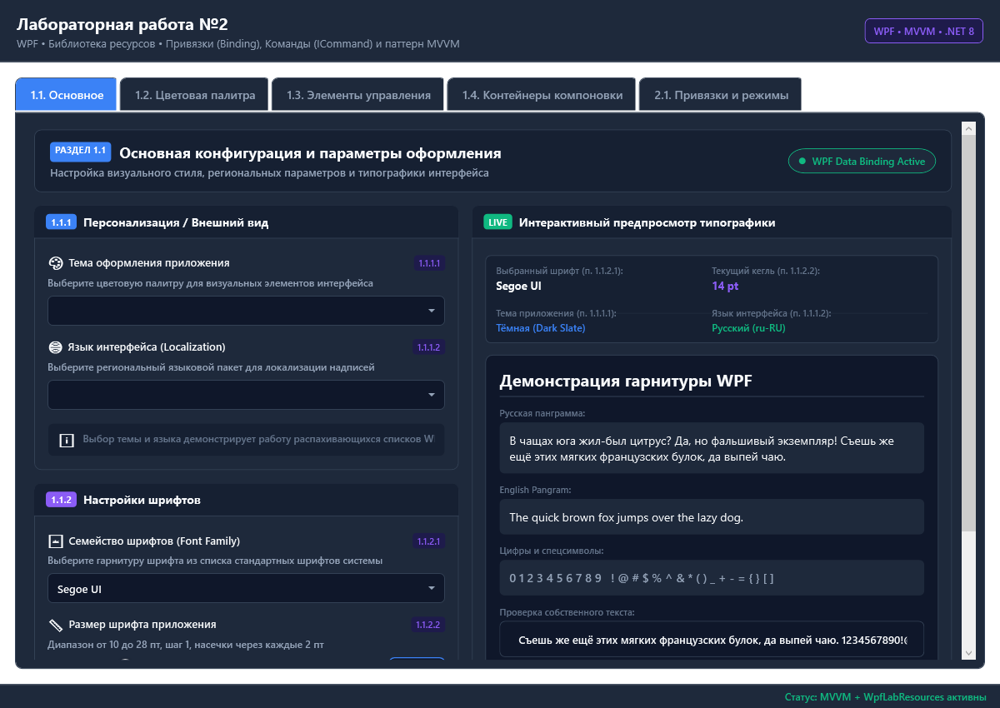
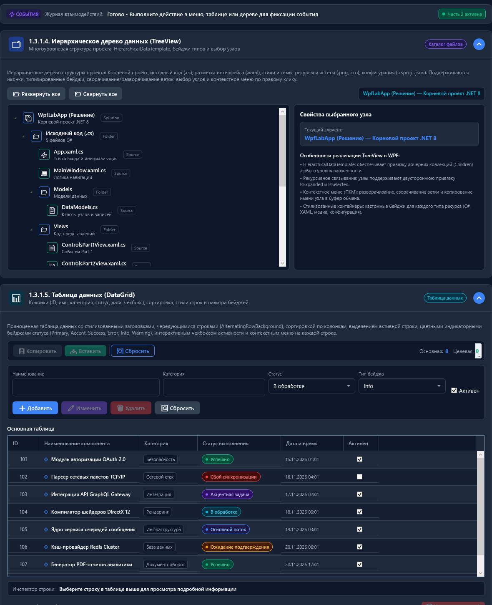
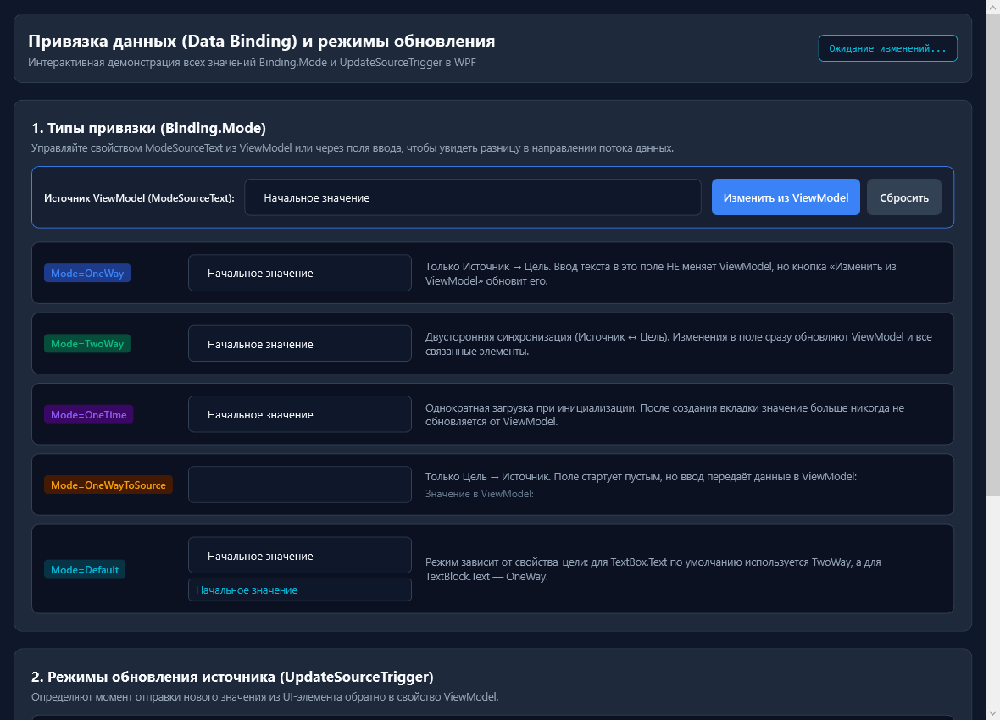

# Лабораторная работа № 2

## Тема: изучение концепций WPF — библиотеки ресурсов, привязки данных, команды и паттерн MVVM

### Сведения о работе
* **Учебное заведение:** Тверской государственный технический университет (ТвГТУ)
* **Факультет:** факультет информационных технологий (ФИТ)
* **Дисциплина:** объектно-ориентированное программирование (ООП)
* **Программный стек:** Microsoft .NET 8.0 SDK (C# 12), Windows Presentation Foundation (WPF), XAML
* **Отчёт по ГОСТ:** [Отчет_ЛР2_Созонтов.docx](Отчет_ЛР2_Созонтов.docx) (текстовая версия: [REPORT_LAB2.md](REPORT_LAB2.md))

---

## 1. Цель и задачи работы

### 1.1. Цель
Изучение ключевых концепций платформы WPF: вынесение ресурсов и стилей в отдельную библиотеку классов (`WpfLabResources`), привязка данных (`Binding`, режимы `Mode` и `UpdateSourceTrigger`), система команд (`ICommand` / `RelayCommand`) и архитектурный паттерн MVVM с уведомлением интерфейса через `INotifyPropertyChanged`.

### 1.2. Задачи
1. Подключить проект к системе контроля версий Git.
2. Создать библиотеку ресурсов приложения в отдельном проекте (`WpfLabResources`) и перевести приложение из ЛР №1 на использование стилей из этой библиотеки.
3. Реализовать логику приложения через привязки и команды (`RelayCommand`), перейдя на архитектуру MVVM (`INotifyPropertyChanged`).
4. Реализовать операции добавления, изменения, удаления и сброса данных в таблице `DataGrid`.
5. Добавить панель инструментов `ToolBar` с кнопками «Копировать» и «Вставить» на командах для копирования строк из основной таблицы во вторую целевую таблицу.
6. Добавить новую вкладку «2.1. Привязки и режимы», демонстрирующую все значения `Binding.Mode` и `UpdateSourceTrigger`.
7. Протестировать приложение, подготовить скриншоты и оформить отчёт по ГОСТ.

---

## 2. Структура решения (`WpfLab1.sln`)

```
├── WpfLabResources/                 Отдельная библиотека ресурсов WPF (.NET 8)
│   ├── Theme/Colors.xaml            Цветовая палитра и кисти тёмной темы
│   ├── Icons/VectorIcons.xaml       Векторные иконки
│   └── Styles/AppStyles.xaml        Общие стили (Button, TextBox, DataGrid, ToolBar, Expander, ProgressBar, Menu)
└── WpfLabApp/                       Основное приложение WPF (MVVM)
    ├── Common/                      ObservableObject (INotifyPropertyChanged), RelayCommand
    ├── Converters/                  ValueConverters (включая EqualityToBooleanConverter)
    ├── Models/                      Модели данных (ProjectTreeNode, DataGridSampleItem и др.)
    ├── ViewModels/
    │   ├── MainWindowViewModel.cs
    │   ├── MainTabViewModel.cs
    │   ├── ColorPaletteViewModel.cs
    │   ├── ControlsViewModel.cs     CRUD-команды и ToolBar Copy/Paste между 2 таблицами
    │   ├── LayoutContainersViewModel.cs
    │   └── BindingsViewModel.cs     Демонстрация Binding.Mode и UpdateSourceTrigger
    └── Views/
        ├── Main/MainTabView.xaml
        ├── Palette/ColorPaletteTabView.xaml
        ├── Controls/ControlsPart1View.xaml & ControlsPart2View.xaml
        ├── Layout/LayoutContainersTabView.xaml
        └── Bindings/BindingsTabView.xaml
```

---

## 3. Скриншоты

### Главное окно


### Вкладка 1.3 — Таблицы DataGrid, CRUD и ToolBar (Копировать / Вставить)


### Вкладка 2.1 — Привязки и режимы обновления

