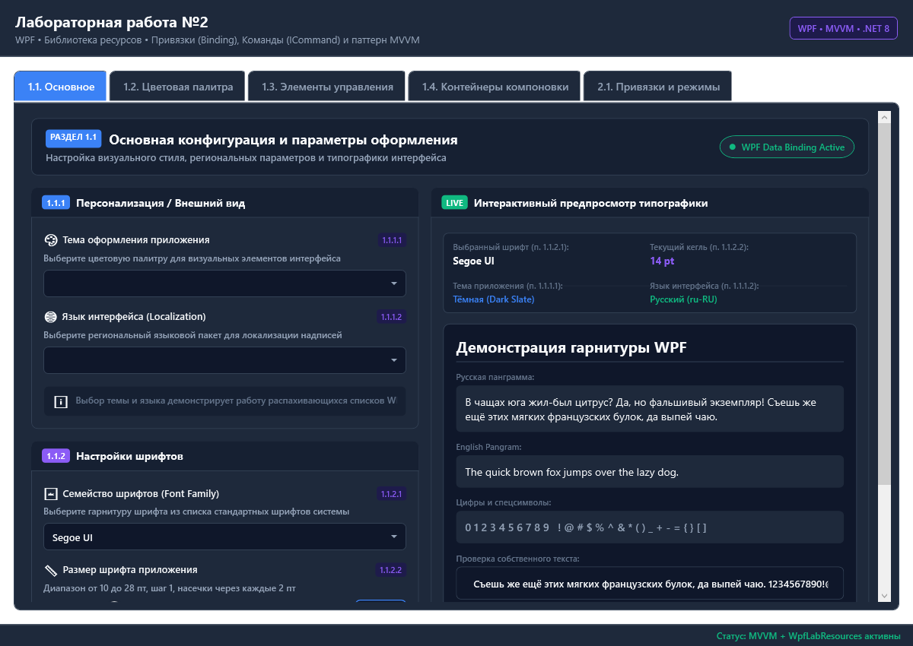
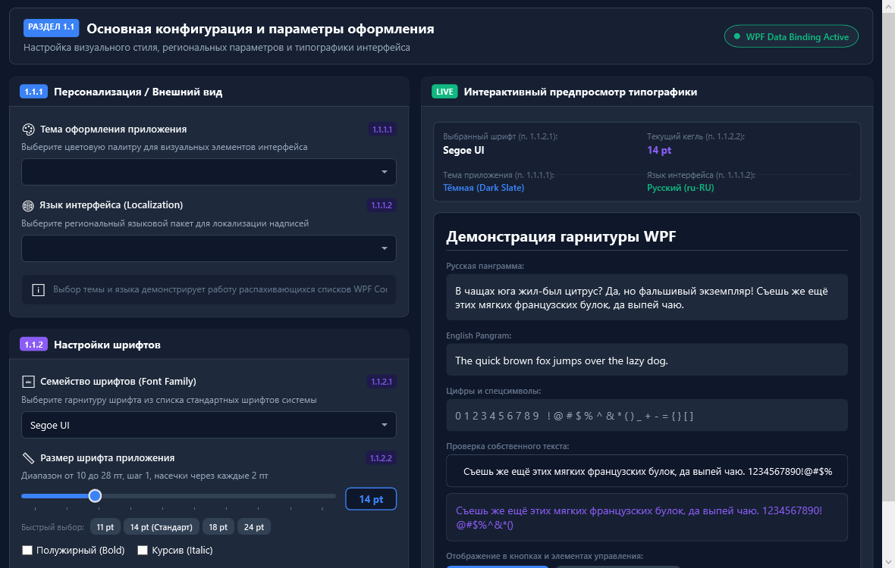
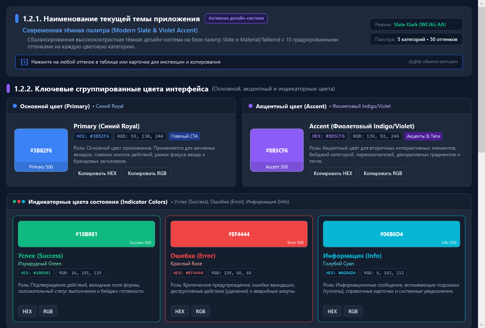
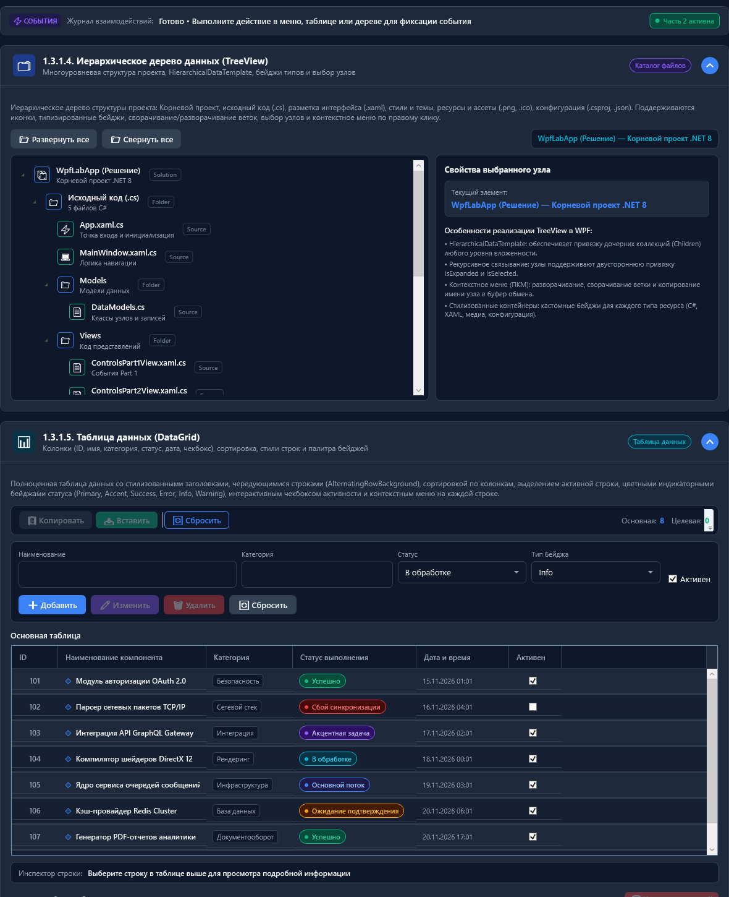
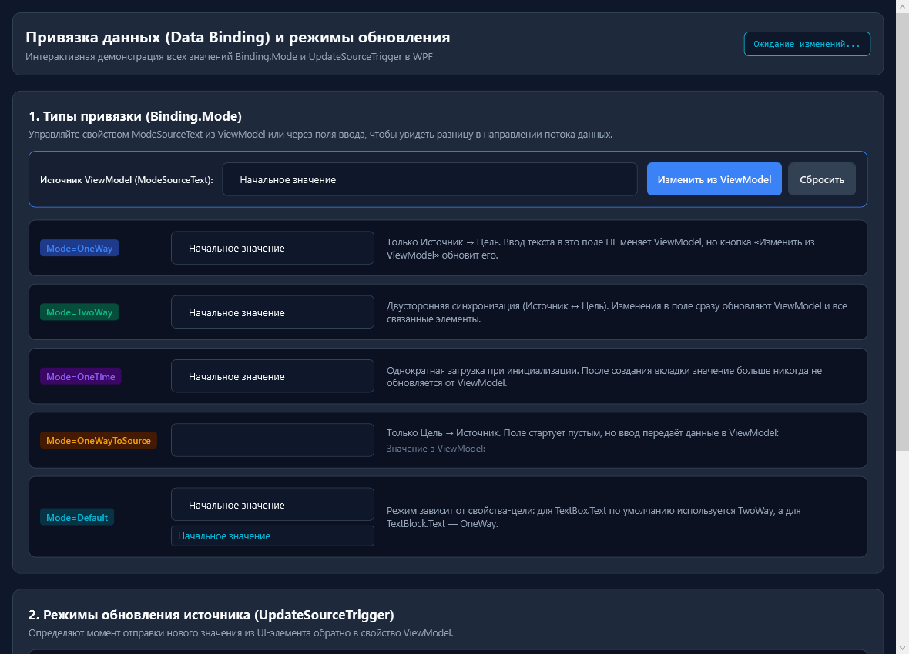

# Отчёт по лабораторной работе №2
**Тема:** Изучение концепций WPF: библиотеки ресурсов, привязки данных, команды и паттерн MVVM.

---

## 1. Цели и задачи

**Цель лабораторной работы** — изучить ключевые концепции WPF: вынесение ресурсов и стилей в отдельную библиотеку классов, привязку данных (`Binding`, режимы `Mode` и `UpdateSourceTrigger`), систему команд (`ICommand` / `RelayCommand`) и архитектурный паттерн MVVM с уведомлением интерфейса через `INotifyPropertyChanged`.

**Задачи:**
1. Подключить проект к системе контроля версий Git.
2. Создать библиотеку ресурсов приложения в отдельном проекте (`WpfLabResources`).
3. Перевести приложение из ЛР №1 на использование стилей и словарей ресурсов из отдельного проекта.
4. Реализовать логику взаимодействия с интерфейсом с помощью привязок и команд (`RelayCommand`), перейдя на архитектуру MVVM (`INotifyPropertyChanged`).
5. Реализовать добавление, изменение, удаление и сброс записей в таблице (`DataGrid`).
6. Добавить панель инструментов (`ToolBar`) с кнопками «Копировать» и «Вставить» на командах для копирования выбранной строки из одной таблицы в другую.
7. Добавить новую вкладку «2.1. Привязки и режимы», демонстрирующую все режимы привязки (`OneWay`, `TwoWay`, `OneTime`, `OneWayToSource`, `Default`) и все режимы обновления источника (`PropertyChanged`, `LostFocus`, `Explicit`, `Default`).
8. Протестировать работу приложения и оформить отчёт со скриншотами.

---

## 2. Описание приложения. Описание используемых элементов

### Архитектура решения (`WpfLab1.sln`)
Решение состоит из двух проектов:
- **`WpfLabResources`** — библиотека классов WPF (`net8.0-windows`, `UseWPF=true`), содержащая:
  - `Theme/Colors.xaml` — цветовая палитра и кисти тёмной темы;
  - `Icons/VectorIcons.xaml` — векторные иконки;
  - `Styles/AppStyles.xaml` — общие стили (`Button`, `TextBox`, `ComboBox`, `CheckBox`, `Slider`, `Expander` / `SectionExpanderStyle`, `DataGrid*`, `ProgressBar`, `ToolBar`, `Menu`, `ContextMenu`).
  Подключается в `WpfLabApp/App.xaml` через `pack://application:,,,/WpfLabResources;component/Styles/AppStyles.xaml`.
- **`WpfLabApp`** — основное WPF-приложение на базе паттерна MVVM:
  - `Common/ObservableObject.cs` — базовая реализация `INotifyPropertyChanged`;
  - `Common/RelayCommand.cs` — реализация `ICommand` для команд без параметров и с параметром;
  - `ViewModels/` — `MainWindowViewModel`, `MainTabViewModel`, `ColorPaletteViewModel`, `ControlsViewModel`, `LayoutContainersViewModel`, `BindingsViewModel`;
  - `Views/` — представления (`UserControl`), освобождённые от бизнес-логики в code-behind.

### Главная оболочка (`MainWindow`)
Главное окно содержит шапку, `TabControl` с пятью вкладками и строку состояния (`StatusBar`), привязанные к `MainWindowViewModel`.

### Вкладки ЛР №1 (переведены на MVVM и `WpfLabResources`)
- **1.1. Основное (`MainTabView` + `MainTabViewModel`)** — выбор темы, языка, шрифта, начертания и размера текста через привязки и команду `SetPresetSizeCommand`.

- **1.2. Цветовая палитра (`ColorPaletteTabView` + `ColorPaletteViewModel`)** — выбор оттенка через привязку `SelectedColor` и копирование HEX/RGB-кодов через `CopyHexCommand` и `CopyRgbCommand`.

- **1.4. Контейнеры компоновки (`LayoutContainersTabView` + `LayoutContainersViewModel`)** — интерактивная настройка `StackPanel`, `Grid`, `WrapPanel`, `DockPanel`, `Canvas` и `UniformGrid` через привязки к ViewModel и конвертер `EqualityToBooleanConverter`.

### Вкладка 1.3. Элементы управления: таблицы, CRUD и панель инструментов
В `ControlsPart2View` (`ControlsViewModel`) реализованы:
- **Панель инструментов (`ToolBar`)** с кнопками **«Копировать»** (`CopyRowCommand`), **«Вставить»** (`PasteRowCommand`) и **«Сбросить»** (`ResetRowsCommand`);
- **Форма редактирования записи** (поля «Наименование», «Категория», «Статус», флаг «Активен») и кнопки **«Добавить»** (`AddRowCommand`), **«Изменить»** (`UpdateRowCommand`), **«Удалить»** (`DeleteRowCommand`);
- **Две таблицы `DataGrid`**: основная (`DataItems`) и целевая (`TargetDataItems`), куда командой «Вставить» добавляется копия выбранной строки из основной таблицы.

### Новая вкладка 2.1. Привязки и режимы (`BindingsTabView` + `BindingsViewModel`)
Вкладка разделена на два блока:
1. **Типы привязки (`Binding.Mode`)**:
   - `OneWay` — обновление только от ViewModel к UI;
   - `TwoWay` — двусторонняя синхронизация;
   - `OneTime` — однократная инициализация при загрузке;
   - `OneWayToSource` — передача значения только от UI во ViewModel;
   - `Default` — поведение по умолчанию (`TwoWay` для `TextBox`, `OneWay` для `TextBlock`).
2. **Режимы обновления источника (`UpdateSourceTrigger`)**:
   - `PropertyChanged` — мгновенное обновление при каждом вводе символа;
   - `LostFocus` — обновление при потере фокуса;
   - `Explicit` — ручное обновление по кнопке «Обновить (UpdateSource)» через `BindingExpression.UpdateSource()`;
   - `Default` — режим по умолчанию (`LostFocus` для `TextBox`).

---

## 3. Трудности, с которыми столкнулись в процессе работы

1. **Изоляция ресурсов в отдельном проекте**: при переносе `Colors.xaml`, `VectorIcons.xaml` и `AppStyles.xaml` в `WpfLabResources` потребовалось корректно указать `pack://application:,,,/WpfLabResources;component/...`, чтобы словари ресурсов загружались из внешней сборки без дублирования в `WpfLabApp`.
2. **Привязка `RadioButton` к перечислениям и числам в MVVM**: стандартный `RadioButton.IsChecked` работает с `bool`, поэтому для привязки к `Orientation` и числу колонок `UniformGrid` был добавлен универсальный конвертер `EqualityToBooleanConverter`.
3. **Команды `CommandParameter` в XAML**: при передаче числовых параметров из XAML в `RelayCommand` значения могут приходить как `string` или `double`, поэтому обработка параметра была унифицирована через `Convert.ToDouble`.
4. **Синхронизация выбора и редактирования в `DataGrid`**: для удобного изменения строки в MVVM потребовалось при изменении `SelectedItem` автоматически заполнять поля редактирования (`EditName`, `EditCategory`, `EditStatus`, `EditStatusType`, `EditIsActive`) и вызывать `RaiseCanExecuteChanged` для команд `UpdateRowCommand`, `DeleteRowCommand` и `CopyRowCommand`.

---

## 4. Вывод

В ходе лабораторной работы №2 приложение из ЛР №1 было успешно переработано в соответствии с архитектурой MVVM: логика перенесена из code-behind в `ViewModel` с уведомлением интерфейса через `INotifyPropertyChanged` и выполнением действий через `RelayCommand`. Стили и ресурсы вынесены в отдельный проект `WpfLabResources`, реализованы операции добавления, изменения, удаления и копирования/вставки строк между двумя таблицами через `ToolBar`, а также добавлена вкладка `2.1. Привязки и режимы`, наглядно демонстрирующая все режимы `Binding.Mode` и `UpdateSourceTrigger`.
